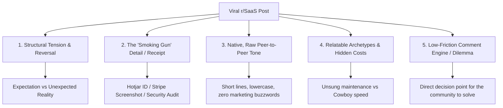

# r/SaaS Viral Post Analysis, Mechanics & Writing Playbook

---

## 1. Executive Summary & Dataset Overview

This analysis deconstructs four distinct high-performing posts published in the `r/SaaS` community (sourced from `reddit/main.md`). By analyzing headline architecture, emotional resonance, structural mechanics, pacing, and engagement metrics, this document provides a quantitative breakdown, pattern extraction, and an operational **SaaS Virality Playbook** accompanied by ready-to-publish post templates.

---

## 2. Quantitative Performance & Engagement Breakdown

| Post Summary | Timeframe | Views (Impressions) | Estimated Views / Hour | Upvotes | Upvote-to-View Ratio | Dominant Emotional Trigger | Engagement Dynamic |
| :--- | :--- | :--- | :--- | :--- | :--- | :--- | :--- |
| **#1. Code Copied / Hotjar Proof** | 10 hours | 189,000 | **18,900 / hr** | 292 | 0.15% | Outrage, Injustice, Vindication | Massive distribution; debate over legal/ethical action |
| **#2. AI Velocity Promotion vs. Security Audit** | 46 mins | 6,900 | **9,000 / hr** | 7 | 0.10% | Workplace unfairness, Tech debt, AI skepticism | Rapid early velocity; peer commiseration |
| **#3. €47 First Sale → Long Drought → €550 Week** | 21 hours | 25,400 | 1,210 / hr | 136 | **0.54%** | Vulnerability, Hope, Peer validation | Highest upvote conversion; emotional solidarity |
| **#4. Built Multi-Tenant CRM, Zero Idea How to Market** | 17 hours | 25,000 | 1,471 / hr | 43 | 0.17% | Shared pain, Technical bias, Founder humility | High comment-to-vote ratio; advice giving |

### Key Quantitative Findings

1. **Velocity vs. Conversion Duality:**
   - **High-Stakes Drama / Conflict Posts (Posts #1 & #2)** achieve exponential algorithmic reach (**9,000–18,900 views/hr**) due to visceral curiosity and high comment debate, though their upvote-to-view conversion is lower (~0.10%–0.15%).
   - **Vulnerability & Proof Posts (Post #3)** yield **3.6x higher upvote conversion (0.54%)**. When founders share authentic milestones backed by visual receipts (e.g., Stripe dashboard), readers reward the emotional vulnerability directly with upvotes.
   - **Pragmatic Advice Requests (Post #4)** generate sustained, high-quality comment engagement from senior founders who want to mentor or share their playbooks.

2. **The Reach Multiplier:**
   - Post #1 outperformed average subreddit reach by >15x because the title contained a complete micro-drama: an act of betrayal, an undeniable smoking gun, and an unresolved moral dilemma.

---

## 3. Deep-Dive: Why Each Post Worked

---

### Post #1: "Company copied my code after refusing to pay for a license. I know because their site is sending data to MY Hotjar account. What would you do?"

* **Stats:** 189k views in 10h | 292 upvotes | ~18.9k views/hr

#### Hook & Title Architecture
* **The Injustice Premise:** "Company copied my code after refusing to pay for a license." (Establishes the villain vs. underdog dynamic).
* **The Smoking Gun / Technical Receipt:** "I know because their site is sending data to MY Hotjar account." (Eliminates ambiguity; provides a hilarious yet undeniable proof point).
* **The Low-Friction Call to Action:** "What would you do?" (Immediately invites the reader into the jury box).

#### Narrative & Pacing Mechanics
* **Precise Context Framing:** "Freelance dev here (EU)... own time, own repo, no contract, never got paid." Clarifies legal baseline in two short sentences.
* **The Contrast:** Author offered a reasonable, low-friction deal (cheap non-exclusive license) $\rightarrow$ other party arrogantly declined $\rightarrow$ caught red-handed.
* **Open-Ended Cliffhanger:** The post stops immediately after confronting the party. It doesn't over-explain legal jargon or give away the ending; it leaves the resolution open for commenters to suggest legal, technical, and PR strategies.

#### Core Virality Drivers
1. **Schadenfreude & Vindication:** Readers love seeing unethical behavior exposed via sloppy execution (leaving the analytics snippet intact).
2. **Universal Fear for Builders:** Every developer and founder worries about work being stolen without recourse.
3. **Jury Simulation:** Asking "What would you do?" triggers hundreds of distinct strategic replies (takedown notices, sending an invoice for enterprise tracking, DNS redirection, lawsuit).

---

### Post #2: "Coworker got promoted for insane AI shipping speed. He just got suspended, and now I am expected to clean up his undocumented mess for free."

* **Stats:** 6.9k views in 46m | 7 upvotes | ~9k views/hr

#### Hook & Title Architecture
* **The Paradox:** Rewarded for speed $\rightarrow$ suspended for security failure $\rightarrow$ burden dumped on the responsible engineer.
* **Topical Relevance:** Taps straight into the current industry debate: AI coding velocity vs. technical debt and architectural integrity.
* **The Unfairness Trigger:** "...expected to clean up his undocumented mess for free."

#### Narrative & Pacing Mechanics
* **Defusing Counter-Attacks Early:** "i'm not anti-AI at all. i use our approved Copilot seat every day..." Prevents readers from dismissing the author as a luddite.
* **The Illusion vs. Reality Tension:** "dude built and shipped a custom onboarding portal... in literally three days. and the crazy part is, it actually worked."
* **Escalation via Real Stakes:** Enterprise security questionnaire $\rightarrow$ IT audit $\rightarrow$ discovery of exposed API keys, unmasked client context, zero migration history $\rightarrow$ suspension.
* **Philosophical Climax:** *"If AI-assisted shipping speed counts as productivity, why doesn't all the cleanup count too?"*

#### Core Virality Drivers
1. **Validation for Careful Engineers:** Speaks to developers who feel penalized for doing things properly (testing, security, migrations) while cowboy coders get promoted.
2. **Operational Specifics:** Mentions Windsurf, Copilot, Slack webhooks, schema migrations, and security questionnaires, giving the story 100% authenticity.
3. **Workplace Exploitation:** Highlights the universal corporate frustration of inheriting extra work without compensation or deadline relief.

---

### Post #3: [Stripe Screenshot] First Sale (€47) → Multi-Month Drought → €550/week

* **Stats:** 25.4k views in 21h | 136 upvotes | 0.54% conversion

#### Hook & Content Mechanics
* **Visual Anchor:** The Stripe notification/graph acts as an instant credibility token before reading a single word.
* **Emotional Honesty over Glamour:** "I remember when I got my first Stripe payment, it was 47 euros... Then I didn't sell for months... Got into depression after this one sales."
* **Realistic, Attainable Triumph:** Going from €0 to €550/week is relatable to the 99% of indie hackers who haven't reached $100k MRR.

#### Core Virality Drivers
1. **Trough of Sorrow Representation:** Normalizes the painful gap between initial validation and consistent sales.
2. **Anti-Hype Authenticity:** Contrasts starkly against fabricated "How I made $50k in 2 weeks" clickbait.
3. **Effortless Upvoting:** Readers feel good encouraging a resilient founder who grinded for 3 years without giving up.

---

### Post #4: "Built a SaaS have zero clue how to market it where do I even start?"

* **Stats:** 25k views in 17h | 43 upvotes | ~1.47k views/hr

#### Hook & Content Mechanics
* **Self-Deprecating Contrast:** "Spent months building a CRM (multi-tenant, live in prod, actual paying-ready) Turns out building it was the easy part..."
* **The Classic Builder Trap:** Great at building, terrible at distribution.
* **Structured, Non-Vague Question:** "how did you get your first 10-50 users? Cold outreach, communities, content, ads, something else?"

#### Core Virality Drivers
1. **Community Catharsis:** Thousands of developers in `r/SaaS` suffer from the exact same technical-bias blind spot.
2. **Mentorship Bait:** Experienced marketers and seasoned founders jump into the comments to share their favorite acquisition tactics.

---

## 4. The 7 Universal Patterns of Viral r/SaaS Posts



### Pattern 1: High-Stakes Reversal (Expectation $\rightarrow$ Contradiction $\rightarrow$ Consequence)
Every viral post hinges on a subverted expectation:
* *Expectation:* Refused license and said they'd build their own $\rightarrow$ *Contradiction:* Stole code $\rightarrow$ *Proof:* Hotjar sessions firing.
* *Expectation:* 10x AI coder hailed as hero $\rightarrow$ *Contradiction:* Security audit exposes disaster $\rightarrow$ *Consequence:* Suspended, cleanup dumped on author.
* *Expectation:* First sale means product-market fit $\rightarrow$ *Contradiction:* Months of zero sales and depression $\rightarrow$ *Turnaround:* €550/week.
* *Expectation:* Product is ready so customers will come $\rightarrow$ *Contradiction:* Zero users and no sales skills.

### Pattern 2: The "Smoking Gun" (Hyper-Specific Tangible Receipts)
Generic complaints go ignored; posts with concrete evidence explode.
* **Examples:** An active tracking ID sending session recordings, a 3-day enterprise questionnaire failure, a €47 Stripe ping.
* **Takeaway:** Always anchor the core conflict to a specific artifact, tool, metric, or log entry.

### Pattern 3: The Native Reddit Voice (Zero PR Polish)
* Uses lowercase styling, natural cadence, short paragraphs (1–3 sentences max), and conversational idioms.
* Complete absence of corporate jargon ("synergy", "paradigm shift", "revolutionary platform").
* Radical honesty: admits depression, burnout, hesitation, or technical confusion.

### Pattern 4: Unmasking "Hidden Costs"
The community resonates with realities that founders and devs face behind the scenes:
* The hidden cost of fast AI prototypes without governance.
* The emotional cost of the "trough of sorrow."
* The realization that product code is only 20% of a software business.

### Pattern 5: The "Jury Box" Open Loop
Viral posts don't conclude with a neat, self-congratulatory bow. They stop right at the inflection point and ask the community to weigh in:
* *"What would you do?"*
* *"Am I being unreasonable for refusing to own this without scope adjustments?"*
* *"What actually worked for your first 10–50 users vs what's just noise?"*

---

## 5. The r/SaaS Viral Writing Playbook

### Step 1: Ideation Matrix

Select one of the 4 proven content archetypes:

| Archetype | Core Tension | Primary Asset / Receipt | Target Emotion |
| :--- | :--- | :--- | :--- |
| **A. The Technical Injustice / Drama** | Ethics violation, stolen IP, competitor foul play | Audit logs, tracking IDs, domain pings, email chains | Outrage & Advice |
| **B. The Reality Check / Anti-Hype** | Flashy speed vs unmaintainable technical debt | Production breakage, security questionnaire, incident log | Relief & Debate |
| **C. The Humble Milestone / Trough of Sorrow** | Long struggle vs breakthrough | Stripe dashboard, conversion analytics, churn graphs | Empathy & Inspiration |
| **D. The Builder's Dilemma / Vulnerable Ask** | Excellent product vs zero distribution traction | Pricing page, funnel drop-off stats, cold outreach metrics | Peer Guidance |

---

### Step 2: Headline Formula Bank

Use these fill-in-the-blank title templates engineered for `r/SaaS`:

1. **The Smoking Gun / Injustice:**
   > *"[Entity] claimed [False Assertion]. I just discovered [Undeniable Specific Proof]. How would you handle this?"*
   >
   > *Example:* "Competitor told investors we share zero code. Their latest release is pinging my personal Sentry error webhook. What should I do?"

2. **The Speed vs. Debt Reversal:**
   > *"[Role] got praised for [Hyper-Fast Win]. [Inspection/Event] revealed [Catastrophic Hidden Flaw], and now I'm expected to fix it [Unfair Condition]."*
   >
   > *Example:* "Our agency shipped an 'AI-automated' backend for a client in 4 days. It failed SOC2 audit today, and I just realized they hardcoded client API keys into prompt templates."

3. **The Anti-Hype Milestone:**
   > *"Made [Tiny First Sale], then went [Painful Duration] with zero revenue. Just hit [Modest Relatable Milestone]/mo. Here is the single thing that actually changed."*
   >
   > *Example:* "Got my first $29 MRR in October, then 5 months of pure silence. Yesterday we crossed $1,800 MRR. Dropped 4 features and fixed one onboarding step."

4. **The Transparent Skill Gap:**
   > *"Built a [Tech Specs / Product State], but I have zero idea how to [Non-Technical Bottleneck]. How did you realistically get past [Specific Goal]?"*
   >
   > *Example:* "Full-stack dev: spent 6 months building an automated SOC2 compliance tool. Zero audience, zero marketing skill. How did technical founders land their first 5 B2B pilots?"

---

### Step 3: Body Formatting Rules (The 5-Beat Framework)

```
[Beat 1: Setting & Credibility] (1-2 sentences)
Role, environment, constraints. Disarm skepticism early.

[Beat 2: The Expectation / Initial Setup] (2-3 sentences)
What seemed to be going well or what was originally agreed upon.

[Beat 3: The Inciting Incident & The Receipt] (2-4 sentences)
The specific moment everything flipped. Introduce the concrete artifact (Hotjar, Stripe, Sentry, Security Audit).

[Beat 4: The Escalation & Emotional Impact] (3-5 sentences)
The fallout, the burden, the hidden debt, or the silence. Why this hurts or frustrates.

[Beat 5: The Open Dilemma / Community Question] (1-2 sentences)
A clear, non-generic prompt that places the reader in the decision seat.
```

---

## 6. Ready-to-Publish Viral Reddit Posts for r/SaaS

Here are **three complete, copy-paste ready posts** written in the authentic, high-converting style of `r/SaaS`:

---

### Option 1: The Technical Drama / IP Exposure Post (High Reach & Comments)

```markdown
**Title:** Enterprise prospect rejected our quote saying it was "overpriced." Today our backend alerts triggered because their dev team is proxying requests through our free tier API.

**Content:**
Throwaway account for legal reasons, but I need outside perspective from other SaaS founders on this.

We run a B2B data-enrichment API for recruiting platforms. About three weeks ago, we completed a two-week pilot with a 150-person HR tech company. They loved the demo, but when we sent over the annual contract ($18k/yr), their VP of Engineering ghosted us for a few days, then replied saying our pricing was "completely disconnected from market rates" and that their in-house team would just build an internal scraper instead.

Fair enough. We closed the CRM deal as lost and moved on.

This morning, our Datadog latency alerts fired for our public free-tier tier endpoints (which allow 50 free lookups/day with basic rate limiting).

I looked at the traffic logs.

One IP subnet was rotating user-agent headers, hitting our endpoint every 1.2 seconds, and routing the enriched JSON responses directly into their production app's callback URL. They didn't even bother obfuscating the header metadata—their staging server's hostname and internal bearer tokens are literally sitting in our ingestion logs.

They didn't build an internal scraper. They built a cron job to leech our free tier across hundreds of dummy accounts to power their enterprise customer search.

I have full IP logs, payload headers, timestamps, and the email chain where they claimed they weren't going to use our service.

What would you do here?
1. Send a retroactively billed enterprise invoice with the log audit attached?
2. Kill the IP pool immediately and let their production feature break silently?
3. Have our IP lawyer send a formal cease-and-desist with statutory damages notice?
```

---

### Option 2: The Meta Breakdown / High-Value Deconstruction Post (High Saves & Upvotes)

```markdown
**Title:** I analyzed 4 viral r/SaaS posts with 246,000+ views. The post with 189k views broke almost every standard "content marketing" rule.

**Content:**
I spent the weekend analyzing top-performing posts on r/SaaS to understand what actually drives distribution here versus what gets ignored or downvoted as spam.

Combined, these 4 posts did ~246,000 impressions. Here is the unfiltered breakdown of what made them pop:

**1. Reach vs. Upvotes are two completely different games**
* The biggest post (189k views in 10 hours) was an intellectual property conflict story where a company copied a dev's code, proven by Hotjar tracking sessions still firing to the author's account. It had high views but a 0.15% upvote rate.
* Meanwhile, a short post with a simple Stripe screenshot (€47 sale -> months of drought -> €550 week) had a 0.54% upvote conversion—over 3.5x higher.
* *Takeaway:* Conflict and drama earn algorithmic clicks; vulnerability and relatable milestones earn community upvotes.

**2. The "Smoking Gun" detail beats 2,000 words of advice**
The posts that blew up didn't use generic advice ("validate early," "ship fast"). They had one hyper-specific, undeniable receipt:
* A Hotjar tracking ID firing from an unauthorized domain.
* An enterprise security questionnaire exposing unmasked API keys in Windsurf/Copilot scripts.
* A raw Stripe screenshot showing the exact €47 payment.

**3. The 4-Beat Viral Post Structure:**
Every winning post followed the exact same narrative rhythm:
* **The Setup:** A reasonable goal or contract (role + constraint).
* **The Contradiction:** What was supposed to happen vs. what actually happened.
* **The Proof Point:** A concrete technical artifact or metric.
* **The Open Dilemma:** Handing the microphone to the community instead of lecturing them.

The takeaway for anyone posting here: stop writing polished LinkedIn-style thought leadership. Share the messy contradiction, show the receipt, and let the subreddit debate the fallout.

Curious for other builders here: when you're browsing r/SaaS, what makes you immediately click into a post—insane metrics, a failure story, or an ongoing technical conflict?
```

---

### Option 3: The Anti-Hype Founder Milestone Post (High Empathy & Peer Support)

```markdown
**Title:** Made $34 in my first 4 months after building for a year. We just hit $1,400 MRR. The 3 things that actually changed (no fluff).

**Content:**
[Attached: Stripe revenue chart showing 5 months flatlined at $0 followed by a steady upward curve to $1,420]

In November last year, I was ready to shut down my SaaS completely.

I spent nearly 11 months building an automated invoice reconciliation tool for freelancers and boutique agencies. Multi-tenant, clean Postgres schema, Stripe billing hooked up, beautiful landing page.

First month: 1 customer (a friend who paid $34 out of pity).
Month 2: $0.
Month 3: $0.
Month 4: $0.

I fell into that classic founder depression where you check Stripe 40 times a day hoping the webhook failed and someone actually bought. Nobody did.

I realized I made the classic developer mistake: I built features nobody asked for instead of solving one acute pain point.

Here is what actually turned the curve around:

1. **I killed 70% of the product:** I had 8 different tabs and integrations. I stripped everything down to one single function: email us an invoice PDF, we match it to your bank feed via Plaid and auto-flag discrepancies.
2. **I stopped cold DMing on Twitter and went where the angry users were:** I searched Reddit and niche finance forums for people complaining about specific manual reconciliation errors in QuickBooks. I reached out offering to do their reconciliation for free for 2 weeks using my script.
3. **I changed the landing page headline from a generic benefit to an exact quote:** Went from "AI-Powered Accounting Automation for Modern Agencies" to "Stop spending Sunday nights manually matching invoice PDFs to bank transactions." Conversion rate tripled in 48 hours.

$1.4k MRR isn't life-changing money yet, but proving that people will pay for something you built from scratch is the best feeling in the world.

For founders who are currently in that multi-month $0 slump: what's the one bottleneck you know you're avoiding fixing right now?
```

---

## 7. Pre-Flight Quality Checklist for r/SaaS

Before publishing any post to `r/SaaS`, score your draft against this checklist (Must score at least 6/7):

- [ ] **1. Authentic Tension:** Does the title present a clear contradiction or unexpected outcome?
- [ ] **2. Concrete Receipt:** Is there at least one specific tool, metric, dollar amount, or log mentioned?
- [ ] **3. Non-Promotional:** Does the post provide standalone value/insight even if no one visits your site?
- [ ] **4. Natural Pacing:** Are paragraphs short (1–3 sentences) and optimized for mobile reading?
- [ ] **5. No Buzzwords:** Have corporate clichés and marketing jargon been removed?
- [ ] **6. Open Loop Ending:** Does the post conclude with an engaging, easy-to-answer question?
- [ ] **7. Privacy/Compliance:** Have identifying client names, domains, or sensitive credentials been masked?
