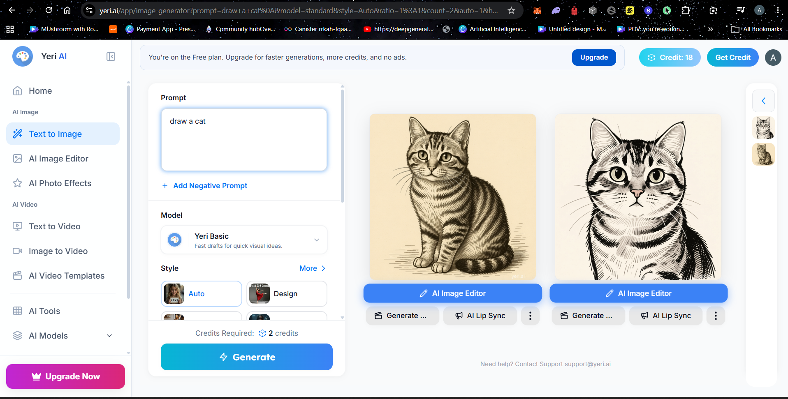
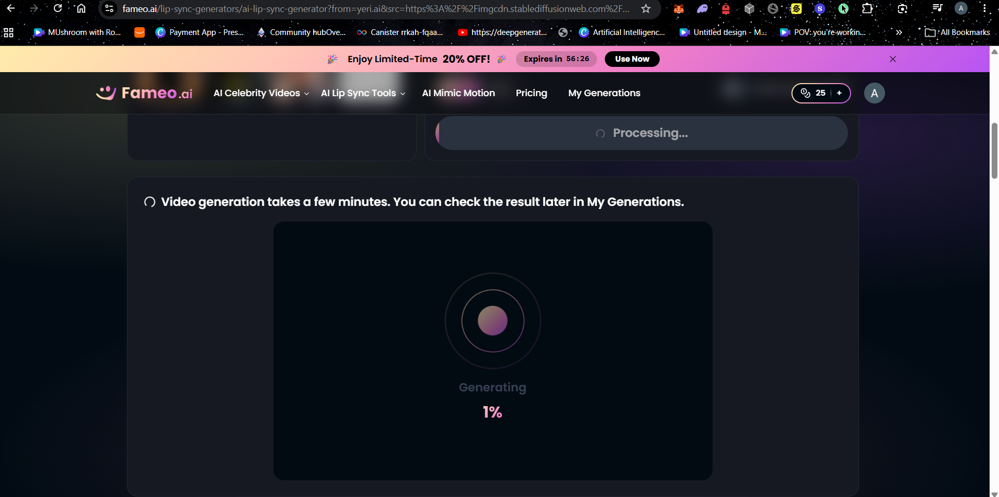

https://webgpu.org/
it is used to make the browser access gpu of a computer here

https://webllm.mlc.ai/docs/user/api_reference.html#api-reference

gmail (google develeoper) => it is used to login into the platform here

https://codelabs.developers.google.com/your-first-webgpu-app#3
(try it out in tutorial)

https://stablediffusionweb.com/
rbranhded to yeri.ai
(to generate )
https://fameo.ai/
used to lip sync it

# AgentCard:

https://www.agentcard.sh/companies

ai agents for 

https://www.klaimee.ai/

create tubro for the projects